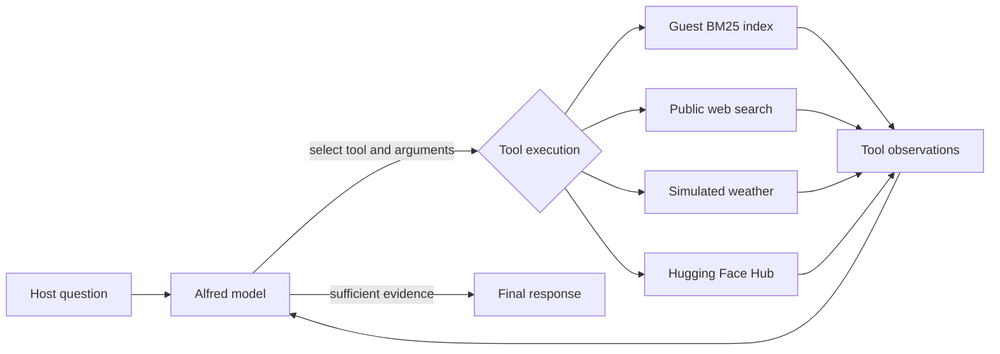

# Alfred: Gala Agent with Agentic RAG

[Open in Google Colab](https://colab.research.google.com/github/jsambruce/AI-Assistant-Alfred/blob/main/Alfred_Gala_Agent.ipynb)

Implements the Hugging Face Agents Course Unit 3 assignment using **smolagents**.
The self-contained `Alfred_Gala_Agent.ipynb` can be uploaded directly into Google Colab.
Python 3.11 or 3.12 is recommended for local execution.

## Requirements and architecture

| Assignment requirement | Implementation |
|---|---|
| Official guest dataset | `datasets.load_dataset('agents-course/unit3-invitees', split='train')` |
| Private guest RAG | In-memory BM25 index over name, relation, description and email; top three positive matches with row references |
| Web search | DuckDuckGo via `ddgs`, returning source URLs |
| Simulated weather | Repeatable city/date scenarios explicitly marked simulated |
| Hub statistics | Live `HfApi` lookup for an author or individual model |
| Autonomous loop | `ToolCallingAgent` chooses JSON tool calls, consumes observations, repeats and produces a final answer; maximum eight steps |



This is agentic RAG because retrieval is a tool the model chooses when relevant,
rather than a mandatory retrieval step before every answer. There is no hardcoded
question router. BM25 uses term frequency, document frequency and length normalization;
it is lexical retrieval, so paraphrases may require a keyword retry. Interests come
from descriptions; the official schema has no separate interests field.

## Run locally

Create a virtual environment, then:

```text
python -m pip install -r requirements.txt
python -m unittest -v
python alfred.py "Tell me about Lady Ada Lovelace from the guestbook."
```

Set `HF_TOKEN` in your environment before the final command. Use a Hugging Face
token with Inference Providers permission. The provider may require credits.
`HF_MODEL_ID` can override the default `Qwen/Qwen2.5-72B-Instruct`; select a currently
available model that supports tool calling. Model/provider availability can change.
The notebook prompts for the token without displaying it and supports Colab Secrets.

## Demonstrations and evaluation

The notebook includes separate guest, weather, Hub, public news and combined-tool
prompts. Run the combined prompt and inspect the tool-name trace: guest retrieval,
web search, weather and Hub statistics should appear. The model determines order
and may retry; factual quality and routing need a live model evaluation.

Offline unit tests cover name/email retrieval, interest retrieval, no-match handling,
schema validation and deterministic, labelled weather. These tests do not establish
live provider, dataset or search availability. Notebook outputs are intentionally
empty in the distributed artifact; no fabricated agent responses are included.

## Privacy and limitations

The course dataset is public teaching material, but is treated as confidential
event context. Records are loaded at runtime and are not bundled in the repository.
Retrieved records are sent to the selected inference provider; this is not a private
or production deployment. Host authorization is assumed, not authenticated. Prompts
instruct the model to keep private details out of external searches; the search tool
also blocks email-like queries. This is a limited safeguard, not general data-loss
prevention. Do not use real confidential guest data without access controls and a
provider/privacy review. Tool outputs are untrusted evidence. Clear notebook outputs
before publishing; they can contain guest details. Weather is simulated and cannot
support real fireworks decisions. Search and Hub failures return explicit statuses.

## Submission

Submit [this public GitHub repository](https://github.com/jsambruce/AI-Assistant-Alfred)
in the course portal. Alternatively, open the notebook using the Colab link above or upload it at
[Google Colab](https://colab.research.google.com/), run it, then enable
Share → General access → Anyone with the link → Viewer and submit the shared link.
No course-portal submission is performed by this project.

## References

- [Course introduction](https://huggingface.co/learn/agents-course/unit3/agentic-rag/introduction)
- [Guest retrieval](https://huggingface.co/learn/agents-course/unit3/agentic-rag/invitees)
- [External tools](https://huggingface.co/learn/agents-course/unit3/agentic-rag/tools)
- [Agent integration](https://huggingface.co/learn/agents-course/unit3/agentic-rag/agent)
- [smolagents API](https://huggingface.co/docs/smolagents/reference/agents)
- [Hub API](https://huggingface.co/docs/huggingface_hub/package_reference/hf_api)
